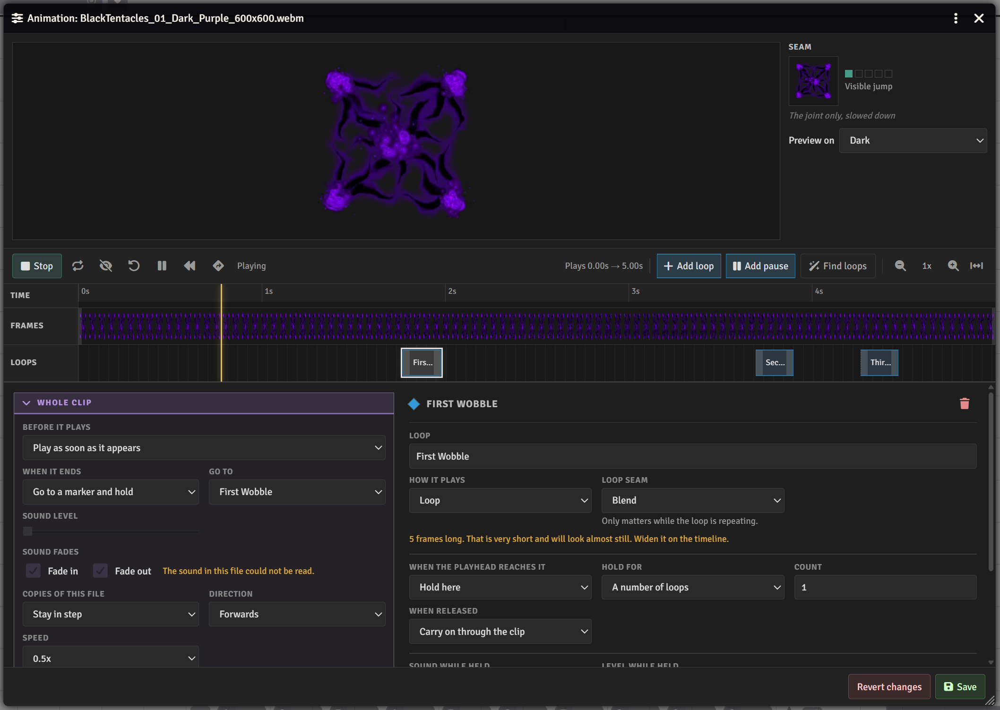
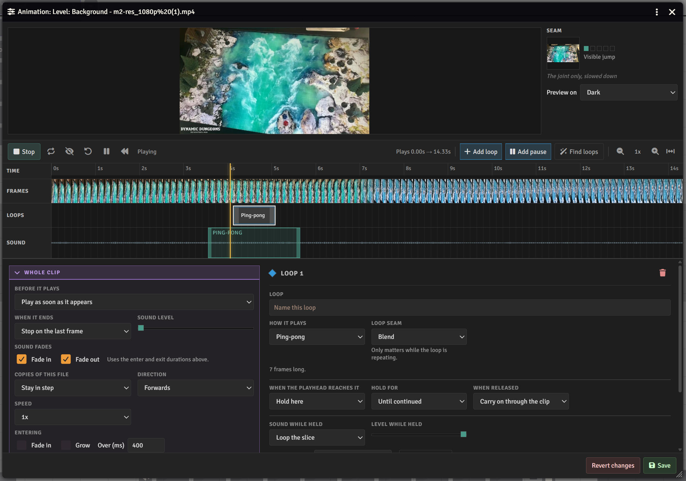
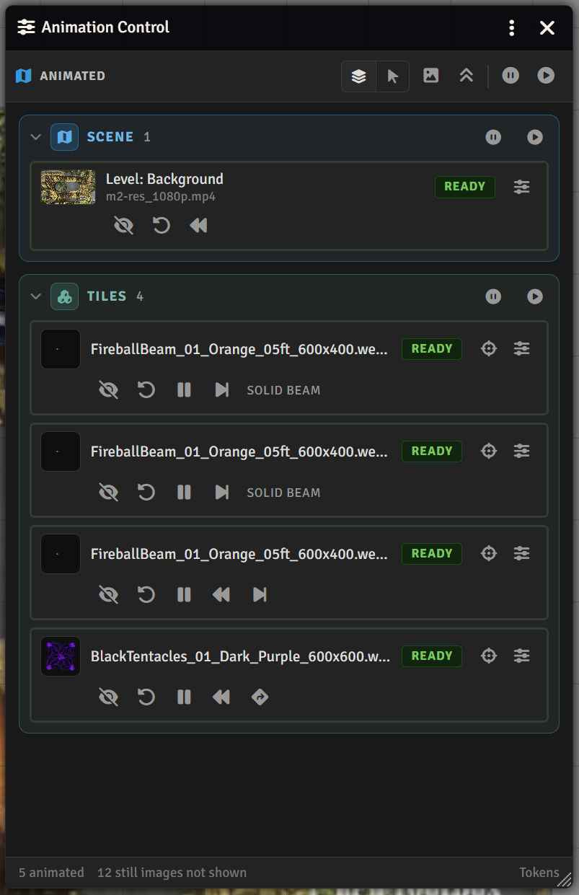
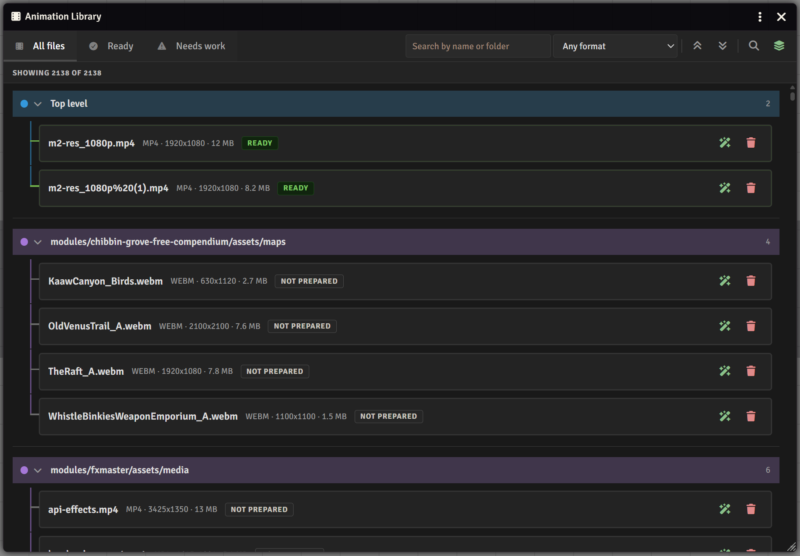
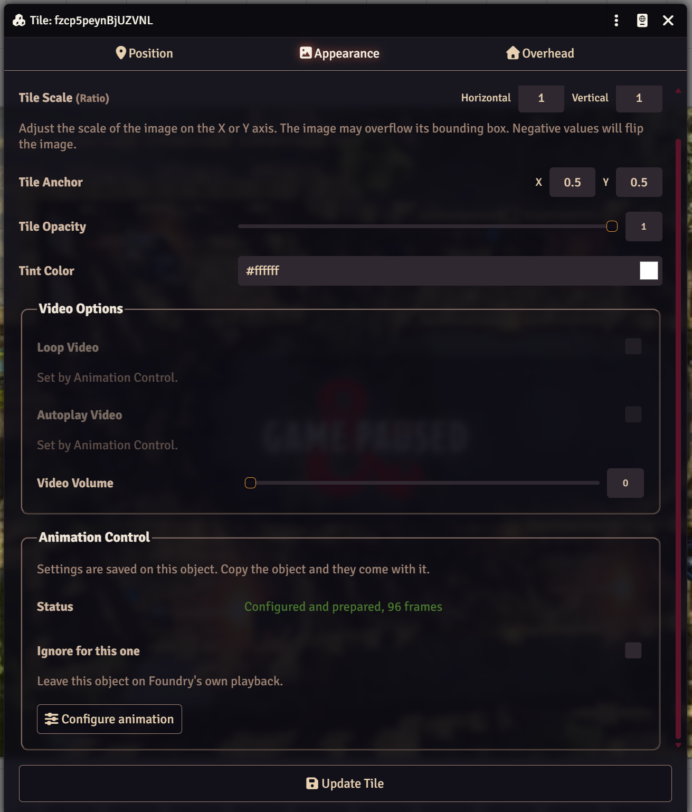
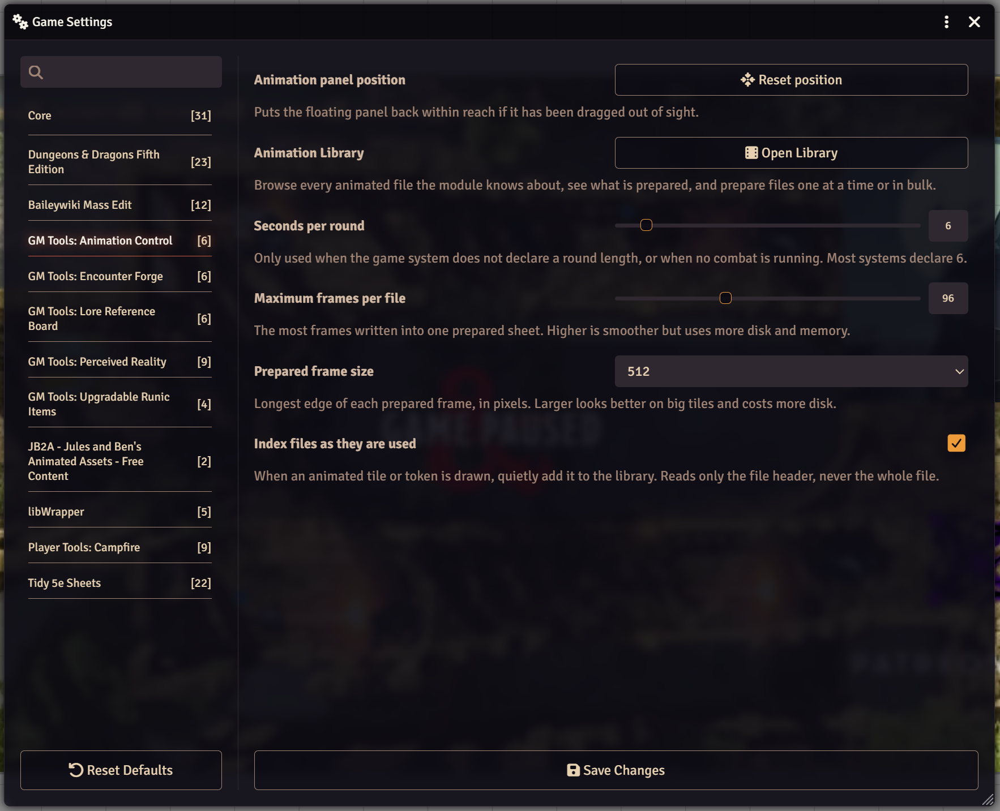

# GM Tools: Animation Control

[](https://patreon.com/Elemor)
[](https://foundryvtt.com)
[](https://github.com/ElemorSeru/animation-control/releases/latest)


A system agnostic Foundry VTT module that lets you decide how an animated tile, scene, or token actually plays. Hold a clip on a section of itself, jump between marked points, run it backwards, fade it out mid scene, or let it play through and stop. Works on webm and mp4, and makes animated GIF, WebP and APNG move on the canvas in the first place, which Foundry doesn't do on its own.

Prepare files from **Game Settings, Module Settings, Animation Library**, or with **Ctrl+Shift+L**. Configure an object from its own sheet. During play, **Ctrl+Shift+A** opens the animation panel, listing everything animated on the scene you are looking at.

Supports Foundry v12 (build 12.328 or later), v13, and v14. See the [Wiki](docs/WIKI.md) for the full walkthrough.

---

## History / Reasoning

I collect animation packs like everyone else, and most of the good ones are built as one continuous clip. A portal spirals open, hangs open for a moment, then collapses, all in four seconds. On the table I almost never want the whole four seconds on repeat. I want the middle: the portal opens once when the party walks in, sits open for however long the scene needs, and closes when they step through.

Foundry gives you loop, autoplay and volume, and that is about it. I actually asked about this years ago on a Foundry stream, around when those options were being added, and the answer was that it was not planned but a module could probably handle it. So a portal that should sit open instead keeps slamming shut every four seconds, and a fire that should just burn keeps restarting with a visible skip.

The usual fix is to cut the file up in a video editor, which I have done more times than I want to admit. It works, and it usually produces a loop that visibly jumps every time it restarts, because the last frame and the first frame do not line up, and I am probably not great at making it loop right. Getting that right by eye is genuinely hard, and it is hard in a way a computer could probably help a person do better in doing.

So this module does the cutting inside Foundry, and does the part I was always bad at: finding where the clean loop actually is. It looks at every prepared frame, works out which pair joins up best, and hands you the answer with a preview already running.

The other thing I wanted was control during play. Being able to tell a portal to close, or an effect to fade out, at the moment the scene calls for it, instead of toggling a tile's visibility and hoping nobody noticed the cut.

---

## The Editor
<p align="center">
  
</p>

Open it with **Configure animation** on a tile, token or scene sheet, or the sliders button in the animation panel. The whole clip is the space you are working in, and you add markers for the parts you want the playhead to catch on.

- **Loops** - a section that repeats until something continues it. A portal gets one over its open state
- **Pauses** - a single frame where playback stops until it's released. Good for a map drawn in stages, like a room slowly flooding
- **Hold for** - until continued, a number of loops, seconds, or combat rounds
- **When released** - carry on through the clip, jump to another marker, or stop
- **When it ends** - stop on the last or first frame, stop and hide, repeat the whole clip, or go to a marker and hold there. This replaces Foundry's own loop checkbox
- **Before it plays** - play as soon as it appears, or wait until you trigger it, shown on its first frame or invisible until then
- **Entering and Leaving** - fade, grow or shrink the whole clip or a single loop on the way in and out
- **Speed, Direction and Copies of this file** - set per object, so two torches on one webm can burn at different rates and drift apart instead of pulsing together
- **Play it** - runs the animation in the preview with your current settings, using the same engine the scene uses, before you save anything

A marker that holds for rounds counts combat on the scene the object is on, so you can look at other scenes to prep the next one and the count keeps going. With no combat running, rounds are counted as time.

---

## Making the Loop Clean

A loop looks like a restart when the frame it ends on and the frame it starts on don't line up. Each marker picks how to handle that.

- **Hard cut** - just jumps. Right when the frames already match, and the cheapest option if you don't want to deal with things
- **Blend** - crossfades the tail of the loop into the head. Handles clips with continuous motion where a cut would be obvious otherwise
- **Ping-pong** - plays the section forwards then backwards, so there's no seam at all. Great for anything that pulses or breathes, wrong for anything moving in a clear direction
- **Find loops** - compares every prepared frame against every other one and suggests the sections that loop best. This is probably where I'll be working further on
- **Seam** - while you drag a loop its seam is scored live, from "Visible jump" to "Seamless", and a small preview plays only the joint, slowed down, so a bad seam is obvious in a couple of seconds

The editor also tells you when a marker is only a few frames wide.

---

## Sound
<p align="center">
  
</p>

The module plays a clip's sound itself, so the table's Ambient Volume slider still controls it. Sound follows the picture. Play the clip backwards and the audio plays backwards, run it at half speed and the audio slows to match, and fade the object out from the HUD and the sound goes out/in with it.

- **Sound level** - set per object and starts at zero, so nothing makes noise until you ask it to
- **Sound fades** - fade the sound in and out along with the object
- **Sound while held** - what happens to the sound while a marker holds the picture:
  - **Let it keep playing** - leaves the audio running underneath
  - **Loop the slice** - repeats a section you pick on the waveform under the filmstrip, crossfaded so it doesn't click
  - **Duck it** - drops the level until the marker is released
  - **Silent** - takes it to nothing

Only one placement of a file makes sound at a time. Eight torches sharing one webm would otherwise stack the same track on itself eight times over, and that's loud and probably annoying.

---

## The Animation Panel
<p align="center">
  
</p>

**Ctrl+Shift+A** opens the animation panel with everything animated on the scene you are looking at, grouped into **Scene**, **Tiles** and **Tokens**. It's where you run things during play. Nothing has to be selected first, and you don't have to switch layers to reach a tile while you're on the token layer. GM only.

Each row has a preview that plays while you hover it, the object's status, and its controls:

- **Play** (play) / **Restart** (circular arrow) - start it, or start it over from the beginning
- **Pause / Resume** - stops everyone on the same frame and picks back up from there
- **Continue** (step forward) - releases a marker that's holding. It shows a stop icon when that marker is set to stop on release
- **Jump to** *marker* (turn arrow) - one for each marker set to pass through, named after it
- **Reverse** (backwards) - plays it backwards. Only on prepared files
- **Fade out / Fade in** (eye) - fades the object and its sound out, then back in
- **Center** (crosshair) - moves the view to the object without selecting it
- **Configure** (sliders) - opens the editor

Around the list:

- **Click a row** to select that object on the canvas, switching to its layer if needed. Shift-click adds to the selection
- **Selection strip** - names everything selected across the top and shows the controls they all share, so you can run several at once
- **Apply to the rest** (clone) - copies one object's settings onto everything else selected, for when you have configured one torch properly and want the other seven to match
- **Pause / Resume all** - each group has its own, and the header pauses or resumes everything on the scene
- **All / Selected** (layers / pointer) - show everything, or only what's selected
- **Stills** (image) - show still images too. They're hidden by default and the footer counts them
- **Collapse / Expand all** (double chevron)
- **Status** - Ready, Paused, Not set up or Not prepared, so you can see what's left to do

The panel resizes. At its default width it's a list, pulled wider it goes to two columns, and popped out or stretched across a second screen it becomes a grid of previews. On v14 it follows the level you're viewing. If the window is ever lost or problematic, there is also a **Reset position** button in module settings.

Selecting a controlled object and right clicking it also adds the same controls to its normal HUD, if you would rather work that way.

Everything you press is synced to the whole table, so a portal closes at the same moment for everyone. A player joining late picks up where everyone else is. Their sound may stay quiet until they click something, since browsers won't start audio before that.

---

## Preparing Files
<p align="center">
  
</p>

**A file has to be prepared before you can configure anything on it**, whatever its format. Preparing reads the file once and saves its frames, so every player gets the same frames on any browser or tablet. It runs on the GM's client, once per file, and never starts on its own.

- **Prepare this file** - on the tile, token, scene or level sheet
- **The editor** - offers it when you open a file that isn't prepared yet, from a sheet or the animation panel
- **The Animation Library** (**Ctrl+Shift+L**, or **Open Library** in module settings) - every animated file the module knows about, with **All files**, **Ready** and **Needs work** tabs, a search box and a format filter. Prepare one file, or everything listed at once
- **Scan for files** - goes through your Data folder for anything animated. Placing an animated tile or token also adds it, reading only the file header so it's quick

Scanning is a separate step from preparing on purpose. A large effects pack can hold thousands of files, so you decide what gets prepared.

**Foundry doesn't animate GIF, animated WebP or APNG on the canvas.** A WebP shows one still frame, and a GIF or APNG doesn't show at all. Prepare the file and it shows up and moves.

---

## Per Object
<p align="center">
  
</p>

Tile and token sheets, scene sheets, and level sheets on v14 gain an **Animation Control** section with the object's status, **Configure animation**, and **Ignore for this one** to leave that object on Foundry's own playback.

- **Settings are saved on the object, not the file.** Two torches using the same webm can behave differently, and copying a configured tile copies its settings too, which is the fastest way to set up repeat objects
- An object you haven't configured is left alone on Foundry's own playback, even if its file is prepared
- While the module controls an object, Foundry's loop and autoplay checkboxes are dimmed and marked. Their saved values are never changed, so you can switch back if you'd like

---

## Settings
<p align="center">
  
</p>

| Setting | Description |
|---|---|
| Animation panel position | **Reset position** puts the animation panel back if it's been dragged out of sight |
| Animation Library | **Open Library** opens the library window |
| Seconds per round | Round length when the game system doesn't declare one, or when no combat is running. Default 6 |
| Maximum frames per file | The most frames saved for one prepared file. Higher is smoother but uses more disk and memory. Default 96 |
| Prepared frame size | Longest edge of each prepared frame, in pixels. Larger looks better on big tiles and uses more disk. Default 512 |
| Index files as they are used | Adds animated tiles and tokens to the library as they're drawn, reading only the file header. On by default |

**Ctrl+Shift+A** (animation panel) and **Ctrl+Shift+L** (library) can be changed under **Configure Controls**.

---

## If you don't want it or it's uninstalled

The module never writes to a source asset. It reads originals and writes new cache files alongside them, and nothing it does can damage a file.

Foundry's own loop and autoplay values on each object are left exactly as you set them, and are overridden only on the live video element in each browser. What the module does store on an object is its own settings and a small record of the last command, both as flags. That's how they reach other players. Without the module, the flags are ignored.

If you disable or uninstall the module, every object returns to normal playback. Its settings stay on each object as ignored flags and its frame sheets stay in storage, so turning it back on picks up where you left off.

---

## Installation

**Method 1: Manifest URL**

In Foundry's module manager, paste the manifest URL:

```
https://github.com/ElemorSeru/animation-control/releases/latest/download/module.json
```

**Method 2: Manual**

Download the latest release zip, extract it into your `Data/modules/` directory, and restart Foundry.

---

## Compatibility

| | |
|---|---|
| Foundry VTT | v12 (build 12.328 or later) - v14 |
| Game Systems | System agnostic. It only changes tile, token and scene images, and reads nothing from the game system except round length, so it behaves the same on dnd5e, PF2e, or anything else |
| Permissions | Preparing needs the GM to have upload permission, which they have by default |

The animation section is added to the standard Tile, Token, Prototype Token and Scene config sheets, and the Level sheet on v14. It works alongside the token sheets dnd5e and PF2e install.

After updating, hard refresh with Ctrl+F5. Foundry doesn't cache-bust nested module files, so a plain reload can leave you running a mix of old and new code.

---

## Data Storage

- **Your settings for an object** - loops, pauses, holds, Entering and Leaving, speed and sound level are a flag on the tile or token itself. That's what makes them travel with a copy and paste. A scene's background and foreground keep theirs on the scene, or on the level on v14.
- **Prepared file records** - where the frame sheet is, the frame delays and dimensions are a world setting keyed by file path, since they describe the file rather than any one object using it.
- **The frame sheets themselves** are images in the module's persistent storage. They're a cache: delete one and that file needs preparing again.

---

## Languages

The module ships with translations for:

- English
- (More as time allows)

---

## About

Built and maintained by [Elemor](https://patreon.com/Elemor).

If you find this useful and want to support continued development, the Patreon link above is the best way to do that.

Bug reports and feature requests are welcome via the Issues tab.
